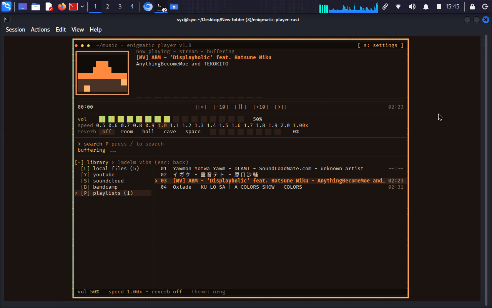
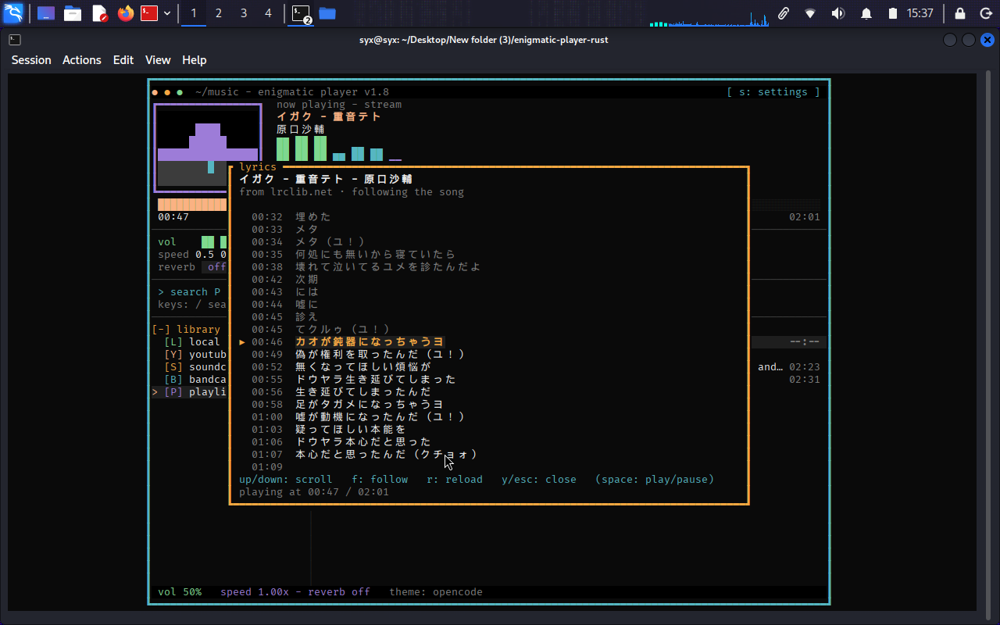
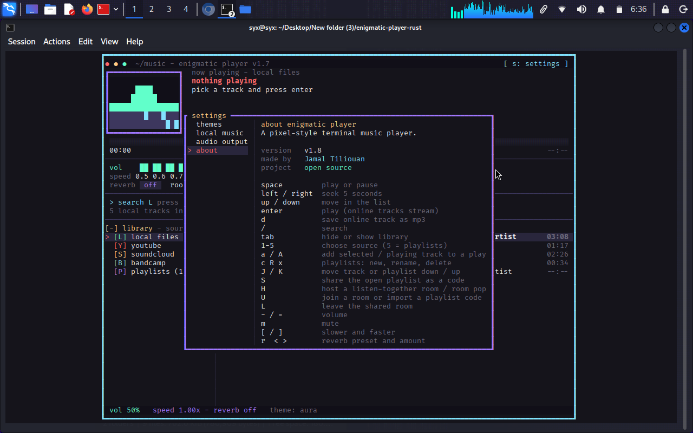

<p align="center">
  
</p>

<h1 align="center">Enigmatic Player</h1>

<p align="center">
  <strong>The most lightweight, fastest way to play YouTube &amp; SoundCloud from your terminal.</strong><br>
  No ads. No browser. No account. Synced lyrics for local and online tracks.
</p>

<p align="center">
  
  
  
  
  
  
  
</p>

Enigmatic Player is a native Rust music player for **YouTube, SoundCloud and your local library**, built for the terminal. It extracts audio directly with `yt-dlp` + `ffmpeg` and draws with `ratatui`, so there is no browser tab, no Electron runtime, no video page and no ads. It is built to be the most lightweight, fastest way to get to a song — and it still brings synced online lyrics, playlists, audio effects and encrypted listen-together rooms into one small binary.

---

## Contents

- [Highlights](#highlights)
- [Why Enigmatic Player?](#why-enigmatic-player)
- [Screenshots](#screenshots)
- [Requirements](#requirements)
- [Quick start](#quick-start)
- [Keyboard controls](#keyboard-controls)
- [Lyrics](#lyrics)
- [Share a playlist](#share-a-playlist)
- [Listen together](#listen-together)
- [Configuration and data](#configuration-and-data)
- [Project layout](#project-layout)
- [Built with](#built-with)
- [Contributing](#contributing)
- [License](#license)

## Highlights

- **Ad-free YouTube, SoundCloud & Bandcamp** — search and stream audio directly with `yt-dlp` + `ffmpeg`. No browser, no video page, no pre-roll, no account.
- **Online synced lyrics** — follows local files and streamed tracks through LRCLIB, with sidecar and embedded lyrics fallbacks.
- **Local library** — scan `.mp3`, `.flac`, `.ogg`, `.wav`, `.m4a`, `.aac` and `.mp4`, with tag-based search and playback.
- **Small native binary** — one Rust executable (~12 MB), fast startup, near-zero CPU while paused, and comfortable over SSH.
- **Listen together** — host an encrypted room over [iroh](https://iroh.computer) with LAN discovery, shareable invites, and rooms for up to 16 people in sync.
- **Playlists that travel** — create, rename, reorder and share playlists as `ELIST1:` codes containing metadata and online URLs only.
- **Audio control** — volume, speed from 0.5× to 2.0×, five reverb presets, live spectrum display, and mouse or keyboard control.
- **33 color themes** — from Catppuccin and Tokyo Night to Gruvbox, Nord, Dracula, Matrix and more.

## Why Enigmatic Player?

Enigmatic Player is built for one job: getting to the song quickly, without the weight of a browser.

| | Enigmatic Player | Browser / web player |
| --- | --- | --- |
| **Ads** | None | Ads and interruptions |
| **Footprint** | One native Rust binary (~12 MB) | Browser tab or Electron app |
| **Streaming path** | Audio-only via `yt-dlp` + `ffmpeg` | Full page, scripts and video |
| **Interface** | Keyboard-first, works over SSH | Mouse-first, desktop only |
| **Lyrics** | Synced, online for local and streamed tracks | Varies by site |
| **Listening together** | Encrypted peer-to-peer rooms | Not included |
| **Idle cost** | Near-zero CPU when paused | Browser stays running |

> **No ads. No browser. No Electron.** Just a fast audio pipeline and a terminal UI that stays out of the way.

Under the hood: native Rust, asynchronous library scanning, on-demand audio streaming, and redraws only when something actually changes.

## Screenshots

<p align="center">
  
  
</p>

<p align="center">
  <em>Left: synced lyrics following the song. Right: built-in settings and keyboard reference.</em>
</p>

## Requirements

| Requirement | Notes |
| --- | --- |
| **Rust** | Current stable toolchain from [rustup.rs](https://rustup.rs) |
| **Audio output** | ALSA/PipeWire/PulseAudio on Linux, CoreAudio on macOS, WASAPI on Windows |
| **Terminal** | At least **80×28**; true-color support recommended |
| **`yt-dlp` + `ffmpeg`** | Optional — required only for online search, streaming and saving |
| **Internet** | Optional — needed for online streaming, LRCLIB lyrics and listening rooms |

The player reports missing optional tools in its status bar instead of failing.

### Install the optional streaming tools

```bash
# Debian / Ubuntu
sudo apt install yt-dlp ffmpeg

# Fedora
sudo dnf install yt-dlp ffmpeg

# macOS
brew install yt-dlp ffmpeg
```

On Windows, install `yt-dlp` and `ffmpeg` and make sure both are on `PATH`.

## Quick start

Download or clone the repository, then:

```bash
cd enigmatic-player-rust
cargo run --release
```

Or build a standalone binary:

```bash
cargo build --release
./target/release/enigmatic-player
```

Then:

1. Press **`s`** to choose your local music folder.
2. Pick a source with **`1`–`5`** (`1` is local files).
3. Press **`/`** to search, or use **`↑`/`↓`** to select a track.
4. Press **`Enter`** to play.
5. Press **`y`** for lyrics, or **`H`** to host a listening room.

### Stream YouTube or SoundCloud without ads

1. Press **`2`** for YouTube or **`3`** for SoundCloud.
2. Press **`/`** and type a song, artist or URL.
3. Press **`Enter`** on a result to start streaming.
4. Press **`y`** to open synced online lyrics while it plays.

`yt-dlp` resolves the audio stream directly; the player never opens a video page, so there are no banner ads, video ads or pre-roll interruptions. `d` saves the current online track as an MP3 for offline listening.

## Keyboard controls

### Playback and audio

| Key | Action |
| --- | --- |
| `space` | Play or pause |
| `Enter` | Play the selected track |
| `n` / `p` | Next / previous track |
| `←` / `→` | Seek back / forward 5 seconds |
| `-` / `=` | Volume down / up |
| `m` | Mute |
| `[` / `]` | Slower / faster playback |
| `r` | Cycle reverb preset |
| `<` / `>` | Reverb amount |
| `q` | Quit |

### Library and playlists

| Key | Action |
| --- | --- |
| `1`–`5` | Local / YouTube / SoundCloud / Bandcamp / Playlists |
| `↑` / `↓` or `k` / `j` | Move selection |
| `PageUp` / `PageDown` | Jump 10 items |
| `/` | Search |
| `Tab` | Hide or show the library panel |
| `Enter` / `d` | Play / download an online track |
| `a` / `A` | Add selected / playing track to a playlist |
| `c` / `R` / `x` | Create / rename / delete playlist |
| `J` / `K` | Move track or playlist down / up |
| `S` | Share the open playlist as a code |
| `s` or `,` | Open settings |

### Lyrics

| Key | Action |
| --- | --- |
| `y` | Open or close the lyrics popup |
| `↑` / `↓`, `j` / `k` | Scroll lyrics |
| `PageUp` / `PageDown` | Scroll faster |
| `Home` / `End` | Jump to the top / bottom |
| `f` | Toggle automatic follow |
| `r` | Reload lyrics |
| `space` | Play or pause |
| `Esc` | Close |

### Listening together

| Key | Action |
| --- | --- |
| `H` | Host a room, or open the room popup |
| `U` | Join a nearby room or import a playlist code |
| `L` | Leave the room |
| `y` | Open lyrics while in a room |
| `Enter` or `c` | Copy the room invite |

## Lyrics

Press **`y`** while a track is playing. Synced lyrics highlight the current line and follow playback; plain lyrics are shown without timing.

This works for **local files and online streams** alike. For a YouTube or SoundCloud track, the player looks up lyrics from the track title, artist and duration, so you can get synced lyrics without downloading the song first.

Lyrics are resolved in this order:

1. **Sidecar file** next to the song with the same stem — `Song.flac` + `Song.lrc` or `Song.txt`.
2. **Embedded tags** — lyrics stored in the audio file's metadata.
3. **Local cache** — previously downloaded lyrics in `~/.cache/enigmatic-player/lyrics/`.
4. **LRCLIB** — the community lyrics database at [lrclib.net](https://lrclib.net), when online lookup is enabled.

The parser supports `[mm:ss]`, `[mm:ss.xx]`, `[mm:ss.xxx]`, multiple timestamps per line, metadata tags and `[offset:]`.

> **Privacy:** online lookup sends only the track title, artist and duration to LRCLIB. Set `ENIGMATIC_NO_LYRICS_ONLINE=1` to keep the player fully offline; sidecar, embedded and cached lyrics still work.

## Share a playlist

1. Open the **playlists** source with **`5`**.
2. Select a playlist and press **`S`**.
3. The player copies an `ELIST1:` share code and saves it to `~/.config/enigmatic-player/shares/<name>.elist.txt`.
4. Another person presses **`U`**, pastes the code (or the file path), and imports the playlist.

Share codes contain **metadata and online URLs only**. They never include local file paths. Local tracks are matched against the importer's own library by tags, then by file name; the import reports anything that could not be found.

## Listen together

A room keeps everyone on the same track, position and play/pause state in real time. Audio is **not** streamed between listeners — everyone plays their own copy, either a matched local file or the same online URL.

There is no server to run or configure:

1. The host presses **`H`**. The app opens an **iroh** peer-to-peer QUIC connection with TLS, using a direct connection when possible and an encrypted public relay otherwise.
2. **LAN discovery:** while a room is open, the host announces it over UDP broadcast. Others on the same network press **`U`** and pick the room from a list.
3. **Remote friends:** send them the `EROOM2:...` invite from the room popup. It works across networks and requires no port forwarding.
4. Press **`L`** to leave. The host ending the room closes it for everyone.

While in a room, only the host changes tracks, seeks or pauses; guests follow automatically and see `live: CODE guest` in the title bar.

### Honest limits

- Room traffic is **encrypted end-to-end** with QUIC + TLS. The public relay forwards ciphertext only. There are no accounts; the 6-character room code is the access control.
- The default **n0** public relays are free, shared and provided without an uptime guarantee. They are suitable for listening with friends, not for a large public service. Direct connections bypass them entirely.
- Only room state (track titles, artists, durations and online URLs) crosses the network — never audio files or local file paths.
- Some Wi-Fi access points filter UDP broadcasts. If LAN discovery is empty, pasting the invite still works.
- Rooms live in memory only. The host identity key is stored in `~/.config/enigmatic-player/identity.key` so the endpoint ID stays stable across restarts.
- `EROOM1:` invites from older builds are recognised but no longer joinable. Ask for a fresh `EROOM2:` invite.

## Configuration and data

| Path | Contents |
| --- | --- |
| `~/.config/enigmatic-player/config.json` | Theme, music folder, volume, speed, reverb, audio device, display name |
| `~/.config/enigmatic-player/playlists.json` | Saved playlists |
| `~/.config/enigmatic-player/shares/` | Saved playlist share codes |
| `~/.config/enigmatic-player/identity.key` | Stable iroh identity for listening rooms |
| `~/.cache/enigmatic-player/` | Library cache, stream temp files and cached lyrics |

Windows uses `%APPDATA%\enigmatic-player\` for configuration and the standard cache directory for temporary data.

### Environment variables

| Variable | Purpose |
| --- | --- |
| `ENIGMATIC_NO_LYRICS_ONLINE=1` | Disable all online lyrics lookups |
| `ENIGMATIC_NAME` | Set the name other listeners see in a room |
| `ENIGMATIC_DEBUG=1` | Enable extra logging in the legacy relay server |

### Command line

```bash
enigmatic-player             # start the terminal player
enigmatic-player --help      # show usage
enigmatic-player --serve     # legacy standalone TCP relay (not used by rooms)
```

## Project layout

```text
.
├── README.md
├── docs/
│   ├── protocol.md
│   └── screenshots/
└── enigmatic-player-rust/
    ├── Cargo.toml
    └── src/
        ├── main.rs        # entry point and draw loop
        ├── app.rs         # application state, input, playback
        ├── ui.rs          # terminal interface and overlays
        ├── audio.rs       # rodio engine, effects, spectrum
        ├── library.rs     # scanning and tag reading
        ├── stream.rs      # yt-dlp + ffmpeg streaming pipeline
        ├── lyrics.rs      # LRC parser and lyric providers
        ├── playlists.rs   # playlist storage
        ├── share.rs       # playlist share codes
        ├── together.rs    # iroh listening rooms
        ├── beacon.rs      # LAN room discovery
        ├── config.rs      # settings and paths
        ├── themes.rs      # 33 color themes
        └── server.rs      # legacy TCP relay
```

## Built with

- [Ratatui](https://ratatui.rs) and [Crossterm](https://github.com/crossterm-rs/crossterm) for the terminal interface
- [rodio](https://github.com/RustAudio/rodio) and [Symphonia](https://github.com/pdeljanov/Symphonia) for audio
- [lofty](https://github.com/Serial-ATA/lofty-rs) for metadata
- [iroh](https://iroh.computer) for peer-to-peer rooms
- [LRCLIB](https://lrclib.net) for community lyrics
- [yt-dlp](https://github.com/yt-dlp/yt-dlp) and [FFmpeg](https://ffmpeg.org) for online media

## Contributing

Issues and pull requests are welcome. Please keep changes focused, build with `cargo build --release`, and run `cargo test` before submitting. Network-dependent tests are marked `ignored` and can be run with:

```bash
cargo test -- --ignored
```

## License

Enigmatic Player is released under the [MIT License](LICENSE). You are free to use, modify and distribute it, including commercially, as long as the copyright notice and permission notice are kept.

Copyright © 2026 Jamal Tiliouan.
